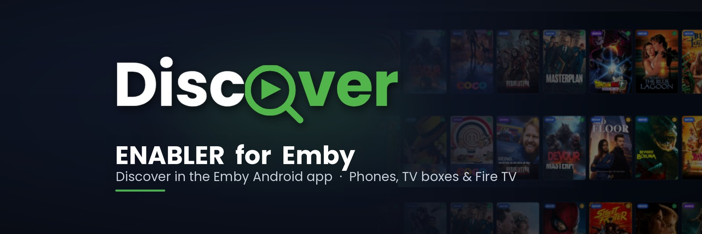

# Discover Enabler

Makes the official **Emby for Android** app (phone/tablet, also runs on Android TV) load the
[Discover Media](https://github.com/mrmuiz/Discover-Media) plugin:

- **Discover** shows in the app's menu (the app normally hides plugin pages);
- the **Discover tile** opens the Discover page, and the **Request** button works on Emby's own detail pages.

Nothing else changes: Emby Premiere, playback and everything else stay exactly as in the original app.
Emby is free to browse your media, while playback requires [Emby Premiere](https://emby.media/premiere.html).

## How to use (Windows)

1. Start `DiscoverEnabler.exe` and choose your device:
   **ARM64** (most phones and tablets), **ARMv7** (Android TV, TV boxes, older phones), **Fire TV** (Amazon Fire TV and Fire tablets),
   **x64** or **x86**. Discover Enabler downloads that Emby app straight from Emby
   ([Emby for Android](https://emby.media/emby-for-android.html)). Already have the APK? Choose it or drop it on the window.
2. Choose where to save it and click **Download and patch**.
3. Uninstall the official Emby app once, then install the new `Emby-…-Discover.apk`.

Discover Enabler signs the app with its own key, kept on your computer
(`%APPDATA%\DiscoverEnabler\signing-key.pfx`). Patch later Emby updates on the **same computer**
(or copy that file), then they install over the patched app without uninstalling again.

The Emby server must have the Discover Media plugin installed.

## What it changes

| File in the APK | Change |
|---|---|
| `assets/www/index.html` | one `<script>` line that loads `discover-web-loader.js` |
| `assets/www/discover-web-loader.js` | added (the same loader the plugin puts in the server's web client) |
| `assets/www/native/android/apphost.js` | `restrictedplugins` set to `false` |

## Not supported

- The separate TV apps **[Emby for Android TV](https://emby.media/emby-for-android-tv.html)** and
  **[Emby for Fire TV](https://emby.media/emby-for-fire-tv.html)** (they have no built-in web client).
  On those devices use the patched **ARMv7** or **Fire TV** build instead; it works with a remote too.
- **iOS**, **Roku**: apps cannot be patched.
- **LG webOS**: Emby offers no app file to download.

## Linux and macOS (command line)

Download `discover-enabler-<system>.tar.gz` for your system from the releases, unpack it and run:

```
./discover-enabler --device arm64            # download from Emby and patch (arm64, armv7, firetv, x64, x86)
./discover-enabler --device armv7 --out ~/Downloads
./discover-enabler emby.apk                  # patch an APK you already have
```

On macOS, allow it once: `xattr -d com.apple.quarantine discover-enabler`.
The signing key is kept in `~/.config/DiscoverEnabler/` (Linux) or the user's app data folder (macOS).
