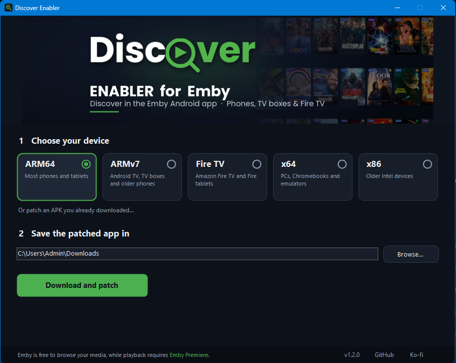

<p align="center">
  <a href="https://ko-fi.com/mrmuiz"></a>
</p>

# Discover Enabler for Emby

Makes the official **Emby for Android** app (phone/tablet, also runs on Android TV, Chromecast with Google TV and Fire TV) load the
[Discover Media](https://github.com/mrmuiz/Discover-Media) plugin:

- **Discover** shows in the app's menu (the app normally hides plugin pages);
- the **Discover tile** always opens the Discover page, and the **Request** button works on Emby's own detail pages;
- optionally, Emby's **server menu** (server settings) is shown in the app. Only administrators see it; the server decides the permissions.

Nothing else changes: Emby Premiere, playback and everything else stay exactly as in the original app.
Emby is free to browse your media, while playback requires [Emby Premiere](https://emby.media/premiere.html).
The Emby server must have the Discover Media plugin installed.

There are two ways to get the patched app:

| | Option 1: **Discover Patcher** (Android app) | Option 2: **Discover Enabler** (Windows, Linux, macOS) |
|---|---|---|
| Runs on | the phone, tablet or TV box itself | your computer |
| Emby download | always the latest official Emby beta for the device | the build you choose (or an APK you already have) |
| Installs Emby | yes, directly on the device | no, you copy the APK to the device |
| Updates | checks daily and notifies you of a new Emby version | patch the new version again yourself |

## Option 1: Discover Patcher (Android)

1. Download `DiscoverPatcher.apk` from the [releases](https://github.com/mrmuiz/Enabler-for-Emby/releases) and install it on the device
   (allow "Install unknown apps" once).
2. Open **Discover Patcher**. It shows what is installed:
   - **Emby is not installed yet**: tap **Download Emby and add Discover**.
   - **An Emby app with a different signature is already installed** (the official app): tap **Uninstall existing Emby app** first.
     Android cannot convert an existing app. You will have to sign in to Emby again; your server and library are not changed.
   - **Patched Emby installed**: the patcher tells you when a new Emby version is available; tap **Update** to install it over the old one.
3. Choose whether the **server menu** (server settings) should show in the app. Changed it later? Tap **Rebuild (force)**.

The app follows the phone language (English, Dutch, German, Norwegian); the activity log is in English.
It works with a remote on Android TV / Chromecast / Fire TV.

The patcher signs Emby with its own key, stored in the patcher's app data. **Do not uninstall Discover Patcher**:
without its key, updates can no longer be installed over the patched Emby (you would have to uninstall Emby first).

Source: [`android/`](android/) (Kotlin, Android Studio / Gradle).

## Option 2: Discover Enabler (Windows)



1. Start `DiscoverEnabler.exe` and choose your device:
   **ARM64** (most phones and tablets), **ARMv7** (Android TV, TV boxes, older phones), **Fire TV** (Amazon Fire TV and Fire tablets),
   **x64** or **x86**. Discover Enabler downloads that Emby app straight from Emby
   ([Emby for Android](https://emby.media/emby-for-android.html)). Already have the APK? Choose it or drop it on the window.
2. Choose where to save it, tick or untick **Show the server menu (server settings) in the app**, and click **Download and patch**.
3. Uninstall the official Emby app once, then install the new `Emby-…-Discover.apk`.

The window follows the Windows language (English, Dutch, German, Norwegian).

Discover Enabler signs the app with its own key, kept on your computer
(`%APPDATA%\DiscoverEnabler\signing-key.pfx`). Patch later Emby updates on the **same computer**
(or copy that file), then they install over the patched app without uninstalling again.

### Linux and macOS (command line)

Download `discover-enabler-<system>.tar.gz` for your system from the releases, unpack it and run:

```
./discover-enabler --device arm64            # download from Emby and patch (arm64, armv7, firetv, x64, x86)
./discover-enabler --device armv7 --out ~/Downloads
./discover-enabler emby.apk                  # patch an APK you already have
./discover-enabler emby.apk --no-server-menu # do not show the server menu in the app
```

On macOS, allow it once: `xattr -d com.apple.quarantine discover-enabler`.
The signing key is kept in `~/.config/DiscoverEnabler/` (Linux) or the user's app data folder (macOS).

## What it changes

| File in the APK | Discover Enabler (computer) | Discover Patcher (Android) |
|---|---|---|
| `assets/www/index.html` | two `<script>` lines: `discover-options.js` and `discover-web-loader.js` | the same, loader in `modules/` |
| `discover-web-loader.js` | added | added |
| `discover-options.js` | added (server menu on/off) | added (server menu on/off) |
| `assets/www/native/android/apphost.js` | `restrictedplugins` set to `false` | unchanged (the loader allows plugin pages) |

## Not supported

- The separate TV apps **[Emby for Android TV](https://emby.media/emby-for-android-tv.html)** and
  **[Emby for Fire TV](https://emby.media/emby-for-fire-tv.html)** (they have no built-in web client).
  On those devices use the patched **ARMv7** or **Fire TV** build instead (or Discover Patcher); it works with a remote too.
- **iOS**, **Roku**: apps cannot be patched.
- **LG webOS**: Emby offers no app file to download.
